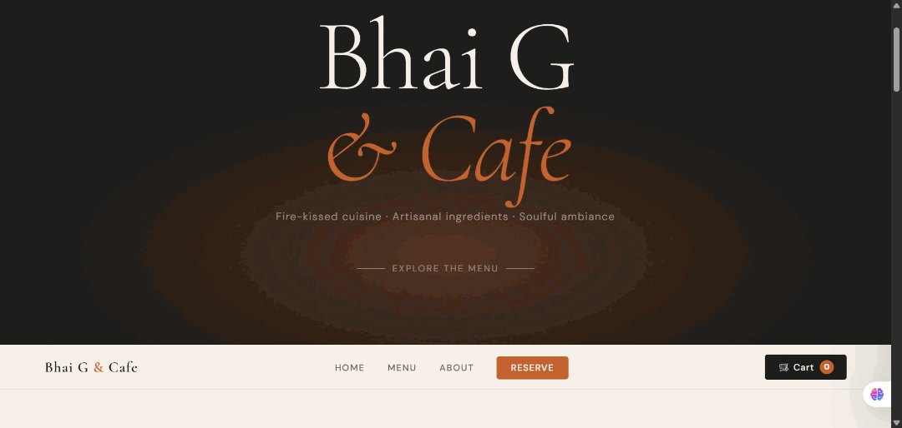

<div align="center">

  

  # GIFforge 🎬⚡
  
  **AI-Powered Screen Recording to GIF — 100% Client-Side, Zero Server Overhead**

  [](#-install--get-started)
  [](#-install--get-started)
  [](#-install--get-started)
  [](#-available-surfaces)
  [](#-privacy--security)
  [](#-license)

  <p align="center">
    Turn screen captures and videos into crisp, lightweight, professional GIFs with intelligent frame selection.
    <br />
    <i>No servers. No signups. No cloud processing. Complete privacy.</i>
  </p>

  <p align="center">
    <a href="#-key-features">Features</a> •
    <a href="#-how-it-works">How It Works</a> •
    <a href="#-install--get-started">Installation</a> •
    <a href="#-faq">FAQ</a> •
    <a href="#-report-an-issue">Bug Report</a> •
    <a href="PRIVACY.md">Privacy Policy</a>
  </p>

  <br />

  

</div>

---

## 💡 Why GIFforge?

Recording a demo shouldn't mean bloated 40MB GIF files, slow online converters that upload your screen to strange servers, or choppy frame rates. 

**GIFforge** brings intelligent computer vision algorithms straight into your browser and workflow:
- 🚀 **Zero Uploads**: Everything runs locally inside your browser via WebAssembly/Canvas and modern Web APIs.
- 🧠 **AI-Assisted Frame Selection**: Uses motion energy, scene disruption scoring, and temporal spacing to discard redundant frames and keep high-impact moments.
- 🎯 **Lightweight Output**: Generates optimized palettes and fluid GIFs tailored for GitHub READMEs, Jira tickets, and documentation.

---

## ✨ Key Features

### 🎥 Multi-Mode Capture
- **Full Screen Recording**: Effortlessly capture complete screen demonstrations with system audio support.
- **Custom Area / Region**: Select an interactive bounding box on your preview to record only what matters.
- **File Import**: Already have a `.mp4`, `.webm`, or `.mov`? Drop it into GIFforge to transform it into a GIF without re-recording.

### 🧠 Smart Frame Intelligence
- **Motion Dynamics**: Prioritizes frames with meaningful delta changes (typing, clicks, animations).
- **Scene Transition Detection**: Prevents visual stutter during sudden transitions or tab switches.
- **Dynamic Sampling**: Automatically calculates the optimal output FPS according to captured frame density.

### 🔒 100% Private by Design
- No tracking pixels.
- No analytics telemetry.
- No remote video processing. Your screen recording **never leaves your machine**.

---

## 📦 Available Surfaces

GIFforge is designed to meet you where you work:

| Surface | Platform | Status | Link |
|---|---|---|---|
| **Browser Extension** | Chrome, Brave, Edge, Opera | 🚀 Active Release | [Chrome Web Store](#) / [Edge Store](#) |
| **Browser Extension** | Firefox | ⏳ AMO Review | Coming Soon |
| **VS Code Extension** | Windows, macOS, Linux | 📦 Published (v1.0.x) | [VS Code Marketplace](#) |
| **Developer CLI** | Terminal (Node.js) | 🛠️ Internal / Enterprise | Contact for access |

---

## 🚀 Install & Get Started

### Browser Extension (Chrome & Chromium Browsers)
1. Install from the official store:
   - [**Chrome Web Store**](#) *(Add link here)*
   - [**Microsoft Edge Add-ons**](#) *(Add link here)*
2. Pin **GIFforge** to your browser toolbar.
3. Click the icon → choose **Full Screen** or **Custom Region** → click **Start Capture**.
4. Perform your demo, hit **Stop**, then click **Generate GIF**!

---

## 🔬 How It Works Under The Hood

```
[ User Screen / Video ]
           │
           ▼
[ Browser MediaStream API ]
           │
           ▼
[ Frame Deconstruction & Canvas Buffer ]
           │
           ▼
[ AI Scoring Pipeline ]
  ├── 1. Motion Magnitude Analysis
  ├── 2. Structural Disruption Bonus
  └── 3. Temporal Spacing Normalization
           │
           ▼
[ Color Quantization & Dynamic Palette Generation ]
           │
           ▼
[ Final High-Fidelity GIF Export ]
```

---

## 🛡️ Privacy & Security

We believe screen recordings contain sensitive code, emails, and credentials. 
- GIFforge operates under an **air-gapped processing model**.
- Network requests are never initiated for media processing.
- Review our complete [Privacy Policy](PRIVACY.md).

---

## 💬 Community & Support

Have an idea to improve GIFforge or spotted a bug? We welcome your input!

- 🐛 [Report a Bug](https://github.com/bsbhadauria/GIFforge/issues/new?template=bug_report.md)
- 💡 [Request a Feature](https://github.com/bsbhadauria/GIFforge/issues/new?template=feature_request.md)
- 📢 [Release Notes & Roadmap](CHANGELOG.md)

> **Notice:** This repository serves as the official issue tracker, user documentation, and showcase hub for the GIFforge product family. The underlying engine and proprietary algorithms are maintained in a private repository. Pull requests containing source code are not accepted.

---

## 📄 License

Copyright © 2026 Bhoopendra Singh. All rights reserved.  
Distributed under a proprietary license. Unauthorized copying, reverse engineering, or redistributing the extension binaries without express written permission is strictly prohibited. See [LICENSE](LICENSE) for details.
